# Cigar Log Application — Software Specification

Nov 23, 2026 · @Eric Stephens

## 1. Summary and key decisions

Build a multi-user cigar log as a React single-page app calling a FastAPI (Python) API over PostgreSQL, with one shared, curated catalog and private per-user smoke logs. The catalog is the hard part, not the app: it is where the normalization you asked for pays off, and where the effort, data-quality risk and moderation burden concentrate.

**Stack:** React 19 + TypeScript (Vite) · FastAPI + SQLAlchemy 2 + Alembic · PostgreSQL 16+ · AWS (static hosting, container compute, managed Postgres, OIDC identity). Infrastructure detail is deferred, per your note; Section 9 only lists what the software needs.

**Seven decisions that shape everything else:**

|    # | Decision                                                                                                                                | Why it matters                                                                                                                              |
| ---: | --------------------------------------------------------------------------------------------------------------------------------------- | ------------------------------------------------------------------------------------------------------------------------------------------- |
|    1 | Two data planes: a shared public catalog and private per-user data, separated by Postgres row-level security                            | Multi-user without leaking one person's log to another; enforced in the database, not only in code                                          |
|    2 | Ownership and production chain is normalized as Company → Brand → Line, with Factory linked to Line (many-to-many, dated)               | Brands change owners, factories build for many brands, and a factory is not a company                                                       |
|    3 | Brand is unique on name plus owner, not name alone                                                                                      | Romeo y Julieta, H. Upmann and Montecristo exist as separate Cuban and non-Cuban brands; a name-only key merges them                        |
|    4 | Blend sits between Line and Size: Line → Blend → Product (size)                                                                         | Wrapper/binder/filler is recorded once per blend, not once per size, and a line can hold several blends (Natural vs Maduro, reformulations) |
|    5 | Blend composition is rows, not columns: one wrapper, one binder, one or more fillers, each pointing at a leaf (origin, varietal, shade) | Filler is plural; leaf-level rows make queries such as "my best-rated Nicaraguan binders" possible                                          |
|    6 | Every catalog fact carries a verification status and source links                                                                       | Unverified blend data is flagged, never silently trusted                                                                                    |
|    7 | User-submitted catalog entries stay private and pending until a curator approves                                                        | Logging never blocks on the catalog, and the shared catalog stays clean                                                                     |

**Portability rule:** the API ships as a plain container and uses Postgres and OIDC generically. Local development must not depend on an AWS emulator's coverage of managed Postgres or the identity service.

Section 12 lists the open questions that would change the design. Answer those before build starts.

## 2. Scope, users and assumptions

Version 1 is a catalog, a smoke log, personal statistics, and import/export for adult users. It does not sell anything, host social features, or manage inventory.

**Roles**

| Role    | Who                       | Can do                                                                                                      |
| ------- | ------------------------- | ----------------------------------------------------------------------------------------------------------- |
| Member  | Any registered adult user | Log smokes; browse the catalog; submit catalog entries (private until approved); import and export own data |
| Curator | Trusted member            | Everything a member can, plus approve, edit, reject and merge catalog entries; manage source records        |
| Admin   | Operator                  | Everything a curator can, plus manage users and roles, view audit logs, run catalog bulk imports            |

**Scope by release**

| Release      | Includes                                                                                                                                                                                             |
| ------------ | ---------------------------------------------------------------------------------------------------------------------------------------------------------------------------------------------------- |
| v1 (MVP)     | Accounts and roles; full catalog model (company, brand, factory, line, blend, size, product); smoke log; search; personal stats; curator queue; YAML/CSV/JSON import and export; bulk catalog import |
| v1.1         | Humidor and inventory (quantity, storage unit, acquired date, age); tags and pairings; band photo upload                                                                                             |
| v2           | Samplers and assortments; opt-in friend sharing; catalog change history UI; public read-only catalog API                                                                                             |
| Out of scope | Sales, affiliate links, price tracking, marketplace, native mobile apps, user-to-user messaging                                                                                                      |

**Assumptions to confirm**

- Scale for year 1: about 1,000 registered users, 25,000 catalog products, 500,000 smoke-log rows. These are planning numbers, not measured; they size the database and set the performance targets in Section 6.
- Users are adults. The app asks for a 21+ attestation at sign-up. Tobacco-related apps can face store-policy and regulatory limits; confirm with counsel before launch (this document is not legal advice).
- Web first, installable as a progressive web app. No native app in v1, which also avoids app-store tobacco policies.
- English only. Sizes are stored in inches and ring gauge, with metric display as a user setting.
- The catalog starts nearly empty and is seeded by curators through bulk import, not scraped from retailers.
- One AWS region, single environment per stage, hobby-scale budget.

## 3. Architecture

One stateless API container sits between the React app and a single PostgreSQL database. An OIDC provider issues identity tokens, and a worker running the same image handles slow jobs.

&#91;embedded content: architecture · client, API tier, data tier, identity provider\]

The browser calls the API with a token; the API validates it and sets the user inside each transaction, and Postgres row-level security enforces isolation a second time.

**Request flow**

1. The browser signs in with the identity provider (authorization code with PKCE) and receives a token.
2. It calls the API over HTTPS with the token as a bearer credential.
3. The API verifies the token, loads the app user, and opens a database transaction.
4. It sets app.current\_user\_id and app.current\_role for that transaction, so row-level security applies to every statement.
5. Routers call services, which hold the business rules; repositories run the SQL.
6. Slow work (imports, exports, statistics refresh) goes onto a queue. A worker running the same image takes the job and sets the user and role recorded in it.

**Architectural rules**

- One database and one schema. The catalog is shared; private rows are separated by user\_id and row-level security. There is no schema or database per user.
- The API and the worker are the same container image started with different commands. Neither holds per-user state in memory.
- Business rules live in services. Rules that must never be violated, such as uniqueness, blend completeness and user isolation, are also enforced by the database.
- Configuration comes from environment variables only, so the same image runs locally and in AWS.
- The frontend never talks to the database or to object storage with long-lived credentials. Files move through short-lived presigned URLs issued by the API.

## 4. Data model

The model has four layers: reference vocabularies, the shared catalog, private user data, and governance. Catalog tables are in third normal form with UUID keys. Appendix A holds the full DDL.

&#91;embedded content: entity relationships · core tables only\]

Arrows run from the one side to the many side. A cigar you log is a product: one blend in one size. Vocabularies, sources, aliases, retailers and governance tables are left out of the drawing.

**Conventions**

- Primary keys are UUIDv7 (time-ordered), except small vocabulary tables, which use smallint.
- Every table has created\_at and updated\_at. Catalog tables also have status (draft, pending, approved, rejected), created\_by, reviewed\_by and archived\_at.
- Names use citext (case-insensitive) with unique indexes on the natural key.
- Foreign keys on catalog tables are ON DELETE RESTRICT. Nothing in the approved catalog is hard-deleted.
- Closed, stable sets (user role, blend component role, source type) are Postgres enums. Sets curators may extend (shape, varietal, leaf color) are vocabulary tables.

**Layer 1: reference vocabularies**

| Table           | Holds                | Notes                                                                                           |
| --------------- | -------------------- | ----------------------------------------------------------------------------------------------- |
| country         | ISO 3166 code, name  | Used by company, factory and leaf                                                               |
| growing\_region | name, country        | Optional detail under a country, such as Jalapa, Estelí, Cibao Valley, Connecticut River Valley |
| leaf\_varietal  | name                 | Habano, Corojo, Criollo, Sumatra, Connecticut Shade, Broadleaf, Cameroon, and so on             |
| leaf\_color     | name, ordinal        | Wrapper color grades, light to dark                                                             |
| leaf\_priming   | name, ordinal        | Position on the plant: volado, seco, viso, ligero                                               |
| shape           | name                 | Parejo, torpedo, belicoso, perfecto, figurado, and so on                                        |
| strength\_level | code, label, ordinal | Mild, mild-medium, medium, medium-full, full                                                    |
| release\_type   | code, label          | Core, limited, annual, regional, retailer exclusive                                             |

**Layer 2: shared catalog**

| Table                                        | Key columns                                                                | Rules                                                                                                          |
| -------------------------------------------- | -------------------------------------------------------------------------- | -------------------------------------------------------------------------------------------------------------- |
| company                                      | name, legal\_name, country\_id, parent\_company\_id                        | Self-reference for corporate parents. Unique on name plus country                                              |
| brand                                        | name, owner\_company\_id, origin\_country\_id                              | Unique on name plus owner. The same name under two owners is two brands                                        |
| factory                                      | name, city, country\_id, operator\_company\_id, active\_from, active\_to   | A factory is a place, not a company. Operator is optional because contract factories serve many brands         |
| line                                         | brand\_id, name, release\_type\_id, introduced\_year, discontinued\_year   | Unique on brand plus name                                                                                      |
| line\_factory                                | line\_id, factory\_id, valid\_from, valid\_to                              | Many-to-many and dated. Ranges for the same pair may not overlap                                               |
| blend                                        | line\_id, name, strength\_level\_id, valid\_from\_year, valid\_to\_year    | A recipe. Named "Standard" if the line has one. A recipe that differs by size is a separate blend row          |
| blend\_component                             | blend\_id, role, leaf\_id, priming\_id, sort\_order, verification          | Role is wrapper, binder or filler. One wrapper, one binder, one or more fillers                                |
| leaf                                         | country\_id, growing\_region\_id, varietal\_id, color\_id, growing\_method | One row per distinct leaf description, reused across blends so it can be queried                               |
| size                                         | length\_in, ring\_gauge, shape\_id                                         | Physical dimensions. Ring gauge in 64ths of an inch. Unique on the triple                                      |
| product                                      | blend\_id, size\_id, vitola\_name, gtin                                    | The loggable cigar: one blend in one size, under the line's own vitola name. Unique on blend plus vitola\_name |
| retailer                                     | name, kind, url                                                            | Where a cigar was bought. Shared and curated like the rest                                                     |
| source                                       | url, title, publisher, source\_type, retrieved\_on                         | One citation record                                                                                            |
| brand\_alias, line\_alias, factory\_alias    | entity id, alias                                                           | Spelling variants and former names, searched alongside the main name                                           |
| line\_source, blend\_source, product\_source | entity id, source\_id                                                      | Ties each fact to its citations                                                                                |

**Layer 3: private user data**

| Table                | Key columns                                                                                                               | Rules                                                                                                                                                                           |
| -------------------- | ------------------------------------------------------------------------------------------------------------------------- | ------------------------------------------------------------------------------------------------------------------------------------------------------------------------------- |
| app\_user            | idp\_subject, email, display\_name, role, trusted, adult\_attested\_at, unit\_system, timezone, disabled\_at, deleted\_at | Identity comes from the OIDC provider. Role is managed by the app                                                                                                               |
| smoke\_log           | user\_id, product\_id, smoked\_on, smoked\_at, rating, perceived\_strength\_id, notes, retailer\_id, client\_request\_id  | smoked\_on is the user's calendar date; smoked\_at is optional. Rating is an integer 0 to 10. Unique on user plus client\_request\_id so a retried mobile post cannot duplicate |
| user\_product        | user\_id, product\_id, daily\_driver, note\_ref                                                                           | Flags that belong to a cigar, not to one smoke                                                                                                                                  |
| tag, smoke\_log\_tag | user\_id, name                                                                                                            | Release v1.1. Context such as "breakfast" becomes a tag                                                                                                                         |

**Layer 4: governance**

| Table                      | Key columns                                                             | Rules                                                                                                          |
| -------------------------- | ----------------------------------------------------------------------- | -------------------------------------------------------------------------------------------------------------- |
| merge\_map                 | entity\_type, old\_id, new\_id                                          | Keeps old links resolving after curators merge duplicates                                                      |
| audit\_log                 | entity\_type, entity\_id, actor\_id, action, before, after, at          | Append-only; before and after are jsonb                                                                        |
| import\_batch, import\_row | file, status, payload, errors                                           | Staging for bulk and personal imports; nothing reaches the catalog until validated                             |
| change\_request            | entity\_type, entity\_id, proposed, status, requested\_by, reviewed\_by | A member's proposed correction to an approved record, stored as jsonb. A curator applies or rejects it (FR-E8) |

**Integrity rules**

1. An approved blend has exactly one wrapper, exactly one binder and at least one filler. Drafts may be incomplete.
2. An approved row may not reference a pending or rejected row.
3. Approved rows are archived or merged, never deleted.
4. Merges run through one database function that repoints every foreign key, including other users' smoke logs, then writes merge\_map and audit\_log. It is the only code path allowed to bypass row-level security.
5. A reformulation adds a new blend row with its own valid years. The old row stays so past smoke logs still show what was smoked.
6. Blend strength is the maker's stated level. Perceived strength is the user's, and lives on smoke\_log.
7. Smoke logs, user\_product and tags are visible only to their owner. Catalog rows are visible when approved, or when created by the current user.

**Where normalization stops**

- Tasting notes and descriptions are free text.
- No entity-attribute-value tables. JSON appears only in audit\_log and import staging.
- Blend percentages are not modeled; makers rarely publish them.
- Packaging (box counts, cello or not) waits for the inventory release.
- Cuban versus non-Cuban is expressed by brand ownership and origin country, not a flag.

**Mapping from the current YAML log**

| YAML field                 | Lands in                                                |
| -------------------------- | ------------------------------------------------------- |
| date                       | smoke\_log.smoked\_on                                   |
| brand, line                | product → blend → line → brand (resolved during import) |
| vitola, dimensions         | product.vitola\_name; size.length\_in, ring\_gauge      |
| wrapper, binder, filler    | blend\_component rows                                   |
| strength (mild to full)    | blend.strength\_level\_id                               |
| nps (0 to 10)              | smoke\_log.rating                                       |
| daily\_driver              | user\_product.daily\_driver                             |
| purchased\_at              | smoke\_log.retailer\_id                                 |
| source URLs                | source, linked through product\_source                  |
| reference\_note (wikilink) | user\_product.note\_ref                                 |
| notes                      | smoke\_log.notes                                        |
| breakfast                  | tag named "breakfast"                                   |

## 5. Functional requirements

The app must let an adult user find any cigar in the shared catalog, log a smoke in seconds, and learn from the data, while keeping the catalog accurate. Release column: v1 = MVP, v1.1 and v2 as in Section 2.

**Accounts and access (FR-A)**

| ID    | Requirement                                                                                                                                          | Release |
| ----- | ---------------------------------------------------------------------------------------------------------------------------------------------------- | ------- |
| FR-A1 | Users register and sign in through an OIDC identity provider; email plus password at minimum, MFA available                                          | v1      |
| FR-A2 | Registration requires a 21+ attestation, stored with a timestamp. Users who decline cannot proceed                                                   | v1      |
| FR-A3 | Three roles: member, curator, admin. Only an admin changes roles, and each change is audited                                                         | v1      |
| FR-A4 | Users can export all their personal data and delete their account. Deletion removes private data; catalog contributions stay, detached from the user | v1      |
| FR-A5 | Profile settings: display name, unit system (inches or millimeters), time zone                                                                       | v1      |

**Catalog browse and search (FR-C)**

| ID    | Requirement                                                                                                                                                                                                                           | Release |
| ----- | ------------------------------------------------------------------------------------------------------------------------------------------------------------------------------------------------------------------------------------- | ------- |
| FR-C1 | Browse the hierarchy company → brand → line → blend → product, with a breadcrumb on every page                                                                                                                                        | v1      |
| FR-C2 | Product page shows brand, line, blend name, wrapper, binder and every filler (each with country, region, varietal and color where known), maker-stated strength, dimensions, vitola name, factories, release type, years, and sources | v1      |
| FR-C3 | Typo-tolerant search across brand, line, vitola and aliases, returning products with their brand and line shown                                                                                                                       | v1      |
| FR-C4 | Filter by wrapper, binder and filler country; varietal; wrapper color; strength; ring gauge; length; factory; company; release type                                                                                                   | v1      |
| FR-C5 | Factory page lists the lines and brands made there, with dates                                                                                                                                                                        | v1      |
| FR-C6 | Each blend component shows its verification status (verified, reported, unverified) with visibly different styling                                                                                                                    | v1      |
| FR-C7 | Compare two to four products side by side                                                                                                                                                                                             | v1.1    |

**Catalog contribution and curation (FR-E)**

| ID    | Requirement                                                                                                                                                        | Release |
| ----- | ------------------------------------------------------------------------------------------------------------------------------------------------------------------ | ------- |
| FR-E1 | Any member can add a company, brand, factory, line, blend, size or product through a guided flow. New entries are pending and usable by their creator at once      | v1      |
| FR-E2 | Before creating an entry, the app shows similar existing names (trigram match, including aliases) and asks the user to confirm it is new                           | v1      |
| FR-E3 | The blend editor has one wrapper slot, one binder slot and a repeatable filler list. Drafts may be incomplete; submission for approval requires all three roles    | v1      |
| FR-E4 | Each contribution takes at least one source URL, or a marker such as "read from the band". Without a source, components are stored as unverified                   | v1      |
| FR-E5 | Curator queue lists pending items by type and age, shows what would change, and supports approve, reject with reason, and edit-then-approve                        | v1      |
| FR-E6 | Curators can merge duplicate brands, lines, blends and products. All references, including users' smoke logs, are repointed and the old identifier keeps resolving | v1      |
| FR-E7 | Approved records are archived or marked discontinued, never deleted                                                                                                | v1      |
| FR-E8 | Members can propose a correction to an approved record. It becomes a change request that a curator reviews                                                         | v1      |
| FR-E9 | Curators see per-record change history: who, what, when                                                                                                            | v1      |

**Smoke log (FR-L)**

| ID    | Requirement                                                                                                             | Release |
| ----- | ----------------------------------------------------------------------------------------------------------------------- | ------- |
| FR-L1 | Create a log entry: product (search or pick), date (defaults to today), rating 0 to 10, notes. Everything else optional | v1      |
| FR-L2 | Optional fields: time, perceived strength, where purchased                                                              | v1      |
| FR-L3 | Edit and delete own entries                                                                                             | v1      |
| FR-L4 | Log against a pending product the user created                                                                          | v1      |
| FR-L5 | "Smoke it again" from history and from the daily-driver list pre-fills a new entry                                      | v1      |
| FR-L6 | History view: newest first, filter by date range, brand, line, rating, strength, wrapper origin; paginated              | v1      |
| FR-L7 | Mark or unmark a product as a daily driver, and keep a link to the user's own notes for it                              | v1      |
| FR-L8 | Offline capture: entries made without a connection queue on the device and sync later without duplicates                | v1.1    |
| FR-L9 | Attach a photo to an entry or to a product contribution                                                                 | v1.1    |

**Statistics (FR-T)**

| ID    | Requirement                                                                                                          | Release |
| ----- | -------------------------------------------------------------------------------------------------------------------- | ------- |
| FR-T1 | Counts over time (month, year) and by brand, line, factory                                                           | v1      |
| FR-T2 | Average rating by wrapper country, varietal and color; binder country; filler country; strength; ring gauge; factory | v1      |
| FR-T3 | Top-rated and most-smoked lists with a date-range filter                                                             | v1      |
| FR-T4 | Every average shows its sample size. Averages with fewer than three entries are marked low-confidence                | v1      |
| FR-T5 | Maker-stated versus perceived strength, per product and overall                                                      | v1.1    |

**Import and export (FR-I)**

| ID    | Requirement                                                                                                                                                           | Release |
| ----- | --------------------------------------------------------------------------------------------------------------------------------------------------------------------- | ------- |
| FR-I1 | Import a personal log from YAML, CSV or JSON using the field mapping in Section 4. A dry run lists matches, ambiguities and errors per row before anything is written | v1      |
| FR-I2 | Rows that match no product can be created as pending catalog entries from the import screen                                                                           | v1      |
| FR-I3 | Export a personal log as YAML, CSV or JSON that re-imports without loss                                                                                               | v1      |
| FR-I4 | Imports are idempotent: importing the same file twice creates no duplicates                                                                                           | v1      |
| FR-I5 | Curators and admins bulk-import catalog data (CSV, JSON, YAML) into staging, review a validation report, then approve the batch                                       | v1      |
| FR-I6 | Export the approved catalog as JSON or CSV                                                                                                                            | v1.1    |

**Administration (FR-D)**

| ID    | Requirement                                                                     | Release |
| ----- | ------------------------------------------------------------------------------- | ------- |
| FR-D1 | Admins list users, assign roles and disable accounts                            | v1      |
| FR-D2 | Admins view and filter the audit log                                            | v1      |
| FR-D3 | Any user can report an incorrect catalog entry; it appears in the curator queue | v1.1    |

**Humidor and inventory (FR-V)**

| ID    | Requirement                                                     | Release |
| ----- | --------------------------------------------------------------- | ------- |
| FR-V1 | Define storage units (name, target humidity, capacity)          | v1.1    |
| FR-V2 | Track quantity per product per storage unit, with acquired date | v1.1    |
| FR-V3 | Optionally decrement stock when a smoke is logged               | v1.1    |

**Acceptance criteria for the requirements that carry the most risk**

- FR-C3: Searching "romeo julieta" returns products from every brand named Romeo y Julieta, each labeled with its owner company.
- FR-E3: Submitting a blend with no binder is rejected with a message naming the missing role. Saving the same blend as a draft succeeds.
- FR-E2: Typing "Padron" while creating a brand lists existing "Padrón" and its aliases before the form allows saving.
- FR-A (privacy): User A requesting User B's smoke-log id receives 404, through the API and through direct database access under A's session.
- FR-I4: Importing the same 100-row file twice leaves 100 smoke-log rows, not 200.
- FR-E6: After merging product X into Y, every smoke log that pointed at X shows Y, and the old X identifier redirects to Y.

## 6. Non-functional requirements

The system must be fast enough that logging a cigar never feels slower than writing it down, safe enough that one user's log is never visible to another, and simple enough for one person to operate. Targets assume the year-1 scale in Section 2 and are starting points to be tuned, not measured values.

**Performance and scalability**

| ID     | Requirement                                                | Target                                                                                                |
| ------ | ---------------------------------------------------------- | ----------------------------------------------------------------------------------------------------- |
| NFR-P1 | Catalog search, server time                                | p95 ≤ 300 ms at 25,000 products                                                                       |
| NFR-P2 | Create a smoke-log entry, server time                      | p95 ≤ 200 ms                                                                                          |
| NFR-P3 | Statistics page, server time                               | p95 ≤ 1 s with 5,000 log rows for the user                                                            |
| NFR-P4 | Largest contentful paint on a mid-range phone over 4G      | ≤ 2.5 s; initial JavaScript ≤ 250 KB gzipped                                                          |
| NFR-P5 | Time from opening the log screen to a saved entry, typical | ≤ 20 s                                                                                                |
| NFR-S1 | Capacity without architecture change                       | 1,000 users, 25,000 products, 500,000 log rows; 10× headroom through indexing and a read replica only |
| NFR-S2 | API holds no per-user state in memory                      | Any instance can serve any request                                                                    |

**Availability and recovery**

| ID     | Requirement                         | Target                                                                                              |
| ------ | ----------------------------------- | --------------------------------------------------------------------------------------------------- |
| NFR-A1 | Monthly availability, single region | 99.5% (about 3.6 hours of downtime a month)                                                         |
| NFR-A2 | Recovery point and time             | RPO ≤ 15 minutes through point-in-time recovery; RTO ≤ 4 hours                                      |
| NFR-A3 | Deployments                         | Rolling, no downtime; migrations use expand-then-contract so the previous API version keeps working |
| NFR-A4 | Backups                             | Retained at least 14 days; a restore tested before launch and quarterly after                       |

**Security**

| ID     | Requirement                 | Target                                                                                                                                            |
| ------ | --------------------------- | ------------------------------------------------------------------------------------------------------------------------------------------------- |
| NFR-X1 | Verification baseline       | OWASP ASVS Level 2                                                                                                                                |
| NFR-X2 | Transport and storage       | TLS 1.2 or higher; HSTS; encryption at rest with managed keys                                                                                     |
| NFR-X3 | Token validation            | Signature through the provider's published keys, issuer, audience and expiry checked on every request; access tokens ≤ 60 minutes                 |
| NFR-X4 | Authorization in two layers | API checks per route, plus Postgres row-level security keyed to the current user. Automated tests prove user A cannot read or write user B's rows |
| NFR-X5 | Secrets                     | None in source or images; read at runtime from a secrets store; database credentials rotatable                                                    |
| NFR-X6 | Input and output handling   | Schema validation at the API edge, parameterized queries only, strict Content-Security-Policy, CORS allow-list                                    |
| NFR-X7 | Rate limiting               | Defaults of 600 reads and 60 writes per minute per user, adjustable                                                                               |
| NFR-X8 | Supply chain                | Dependency and container scanning in CI; critical findings fixed within 7 days                                                                    |
| NFR-X9 | Audit                       | Role changes, approvals, merges, deletions and exports are logged and kept 1 year                                                                 |

**Privacy**

| ID     | Requirement         | Target                                                                                                                      |
| ------ | ------------------- | --------------------------------------------------------------------------------------------------------------------------- |
| NFR-R1 | Visibility          | Smoke logs are private to their owner in v1. Any later community average needs at least 10 raters and exposes no identities |
| NFR-R2 | Data minimization   | Store email, display name and the 21+ attestation timestamp. Do not store date of birth                                     |
| NFR-R3 | Export and deletion | Export is self-service and immediate. Deletion removes private data at once and ages out of backups within 35 days          |
| NFR-R4 | Logging             | No email addresses or free-text notes in application logs                                                                   |
| NFR-R5 | Legal text          | Privacy policy and terms of use published before first external user                                                        |

**Observability**

| ID     | Requirement        | Target                                                                                                                                  |
| ------ | ------------------ | --------------------------------------------------------------------------------------------------------------------------------------- |
| NFR-O1 | Logs               | Structured JSON with request id and an opaque user id                                                                                   |
| NFR-O2 | Metrics and alerts | Request rate, error rate and latency per route, database pool use. Alert on 5xx above 2% for 5 minutes and p95 above 1 s for 10 minutes |
| NFR-O3 | Tracing            | OpenTelemetry instrumentation, exporter configurable                                                                                    |
| NFR-O4 | Health checks      | A liveness endpoint, and a readiness endpoint that confirms the database answers                                                        |

**Maintainability and quality**

| ID     | Requirement     | Target                                                                                                          |
| ------ | --------------- | --------------------------------------------------------------------------------------------------------------- |
| NFR-M1 | Test coverage   | API line coverage ≥ 80%; 100% of paths in the merge function and row-level-security policies                    |
| NFR-M2 | Static checking | Python type-checked in strict mode; TypeScript strict; linters in CI                                            |
| NFR-M3 | API contract    | OpenAPI document generated from code and committed; the frontend client is generated from it; CI fails on drift |
| NFR-M4 | Schema changes  | Only through reviewed Alembic migrations                                                                        |
| NFR-M5 | Decisions       | Significant choices recorded as short architecture decision records in the repository                           |

**Portability and developer experience**

| ID     | Requirement              | Target                                                                                           |
| ------ | ------------------------ | ------------------------------------------------------------------------------------------------ |
| NFR-D1 | One-command local stack  | Postgres, API, frontend, a local OIDC provider and an AWS emulator start from one compose file   |
| NFR-D2 | Configuration            | Environment variables only; AWS endpoint override supported                                      |
| NFR-D3 | Same artifact everywhere | One container image runs locally, in test and in production; no emulator-specific code paths     |
| NFR-D4 | Seed data                | A script loads a demo catalog (at least 50 products, 5 companies, 3 factories) in under a minute |

**Accessibility and compatibility**

| ID     | Requirement          | Target                                                                                          |
| ------ | -------------------- | ----------------------------------------------------------------------------------------------- |
| NFR-U1 | Accessibility        | WCAG 2.2 AA; keyboard operable; verification status never conveyed by color alone               |
| NFR-U2 | Browsers and screens | Last two versions of Chrome, Safari (including iOS), Firefox and Edge; usable from 360 px width |
| NFR-U3 | Theme                | Follows the system light or dark setting                                                        |

**Data quality**

| ID     | Requirement           | Target                                                                                                               |
| ------ | --------------------- | -------------------------------------------------------------------------------------------------------------------- |
| NFR-Q1 | Verification coverage | Every approved blend component has a verification status; the admin view reports the unverified share                |
| NFR-Q2 | Import integrity      | A bulk import runs in one transaction. Invalid rows are reported and skipped only if the curator chooses to continue |

**Cost**

| ID     | Requirement           | Target                                                                                                                             |
| ------ | --------------------- | ---------------------------------------------------------------------------------------------------------------------------------- |
| NFR-C1 | Hobby-scale footprint | Runs on the smallest managed Postgres class and one small API task in v1. The monthly ceiling is for the owner to set (Section 12) |

## 7. API specification

The API is a versioned REST/JSON service under /v1, built with FastAPI so the OpenAPI 3.1 document is generated from the code. The frontend consumes a client generated from that document.

**Conventions**

- Authentication: bearer JWT from the OIDC provider. The API verifies signature, issuer, audience and expiry, then loads or creates the app\_user row on first sight.
- Per-request database context: each request opens one transaction and runs SET LOCAL app.current\_user\_id and app.current\_role before any query, so row-level security applies. SET LOCAL is used, not SET, so it is safe behind a transaction-mode connection pooler.
- Identifiers are UUIDs. Lists use cursor pagination (limit, cursor), never offset.
- Errors follow RFC 9457 problem details (type, title, status, detail, instance, plus field errors).
- Writes that a phone may retry (POST /smoke-logs, imports) accept an Idempotency-Key header. A repeat returns the original result.
- Edits to catalog records use ETag and If-Match; a stale edit returns 412 so two curators do not overwrite each other.
- Rate limits return 429 with Retry-After.
- Merged records answer 301 with the surviving record's URL.

**Resources**

| Area                       | Endpoints                                                                                                                    | Access                                             |
| -------------------------- | ---------------------------------------------------------------------------------------------------------------------------- | -------------------------------------------------- |
| Session                    | GET /v1/me; PATCH /v1/me; POST /v1/me/export; DELETE /v1/me                                                                  | Member                                             |
| Vocabularies               | GET /v1/vocab/{countries, regions, varietals, colors, primings, shapes, strengths, release-types}                            | Member read; curator write                         |
| Companies                  | GET, POST /v1/companies; GET, PATCH /v1/companies/{id}                                                                       | Member read and create (pending); curator edit     |
| Brands                     | GET, POST /v1/brands; GET, PATCH /v1/brands/{id}; GET /v1/brands/{id}/lines                                                  | Same                                               |
| Factories                  | GET, POST /v1/factories; GET, PATCH /v1/factories/{id}; GET /v1/factories/{id}/lines                                         | Same                                               |
| Lines                      | GET, POST /v1/lines; GET, PATCH /v1/lines/{id}; PUT /v1/lines/{id}/factories                                                 | Same                                               |
| Blends                     | GET, POST /v1/blends; GET, PATCH /v1/blends/{id}; PUT /v1/blends/{id}/components                                             | Same. Components are replaced as one validated set |
| Leaves                     | GET, POST /v1/leaves                                                                                                         | Same                                               |
| Sizes                      | GET, POST /v1/sizes                                                                                                          | Same                                               |
| Products                   | GET, POST /v1/products; GET, PATCH /v1/products/{id}                                                                         | Same                                               |
| Search                     | GET /v1/search?q=&type=&filters                                                                                              | Member                                             |
| Sources                    | GET, POST /v1/sources                                                                                                        | Member                                             |
| Change requests            | POST /v1/change-requests; GET /v1/change-requests/{id}                                                                       | Member create; curator review                      |
| Curation                   | GET /v1/curation/queue; POST /v1/curation/{type}/{id}/approve; POST /v1/curation/{type}/{id}/reject; POST /v1/curation/merge | Curator                                            |
| Smoke logs                 | GET, POST /v1/smoke-logs; GET, PATCH, DELETE /v1/smoke-logs/{id}                                                             | Owner only                                         |
| My products                | GET /v1/me/products; PUT /v1/me/products/{product\_id}                                                                       | Owner only                                         |
| Stats                      | GET /v1/stats/summary; GET /v1/stats/by/{dimension}                                                                          | Owner only                                         |
| Personal import and export | POST /v1/imports (dry\_run flag); GET /v1/imports/{id}; POST /v1/imports/{id}/commit; GET /v1/exports?format=                | Owner only                                         |
| Catalog bulk import        | POST /v1/admin/catalog-imports; GET, POST /v1/admin/catalog-imports/{id}/commit                                              | Curator or admin                                   |
| Admin                      | GET /v1/admin/users; PATCH /v1/admin/users/{id}; GET /v1/admin/audit                                                         | Admin                                              |
| Operations                 | GET /healthz; GET /readyz                                                                                                    | Unauthenticated                                    |

**Search and filters**

GET /v1/search takes q plus any of: wrapper\_country, binder\_country, filler\_country, varietal, wrapper\_color, strength, ring\_gauge\_min, ring\_gauge\_max, length\_min, length\_max, factory\_id, company\_id, release\_type. The response is a list of products, each with brand, line, blend name and a one-line blend summary. Matching uses trigram similarity plus full-text search over names and aliases.

**Stats dimensions**

GET /v1/stats/by/{dimension} accepts brand, line, factory, wrapper\_country, wrapper\_varietal, wrapper\_color, binder\_country, filler\_country, strength, ring\_gauge and month. Each row returns count, average rating and sample size.

**Example: create a smoke log**

```
POST /v1/smoke-logs
Idempotency-Key: 0192f8e2-6c1a-7d2e-9b44-3f1c0a7e5b10

{ "product_id": "0192f8d9-...", "smoked_on": "2026-11-23",
  "rating": 8, "notes": "Even burn, cocoa and cedar",
  "perceived_strength": "medium" }

201 Created  { "id": "...", "product": { ... }, "rating": 8, ... }
```

**Backend module layout**

The API is organized by domain so each can be tested alone: catalog (company, brand, factory, line, blend, product, search), curation (queue, merge, change requests), logging (smoke logs, user products), stats, imports, identity, and admin. Each domain has routers, services holding business rules, and repositories holding SQL. Routers never touch the database directly.

## 8. Frontend specification

The frontend is a mobile-first React single-page app, installable as a progressive web app, built around one job: getting a smoke logged in about 20 seconds. Everything else (catalog, stats, curation) is secondary navigation.

**Stack**

| Concern            | Choice                                         | Note                                                                              |
| ------------------ | ---------------------------------------------- | --------------------------------------------------------------------------------- |
| Language and build | TypeScript (strict), React 19, Vite            | Static output, hosted from object storage behind a CDN                            |
| Routing            | TanStack Router                                | Type-safe routes and search params, which suits filter-heavy screens              |
| Server state       | TanStack Query                                 | Caching, retries, optimistic updates; cache persistence added in v1.1 for offline |
| Forms              | React Hook Form with Zod                       | Schemas mirror API validation rules                                               |
| API client         | Generated from the OpenAPI document            | CI fails if the generated client is stale                                         |
| Styling            | Tailwind CSS with Radix primitives             | No heavy component library                                                        |
| Charts             | Recharts or visx                               | Bar and line only; every value labeled with its sample size                       |
| Authentication     | OIDC authorization code with PKCE              | Tokens held in memory, never in local storage                                     |
| Offline            | Workbox service worker                         | App shell in v1; queued writes in v1.1                                            |
| Testing            | Vitest, React Testing Library, Playwright, MSW | End-to-end tests run against the local compose stack                              |

**Navigation**

A bottom tab bar on phones (Log, History, Catalog, Stats, More) and a left sidebar on wide screens. Curator and Admin entries appear under More only for those roles.

**Screens**

| Screen            | Purpose                     | Key behavior                                                                                                                                                                                                                     |
| ----------------- | --------------------------- | -------------------------------------------------------------------------------------------------------------------------------------------------------------------------------------------------------------------------------- |
| Log a smoke       | Home screen. Record a cigar | Search box with recent cigars and daily drivers as one-tap chips; date defaults to today; rating 0 to 10; notes; one Save button reachable by thumb                                                                              |
| History           | Review past smokes          | Newest first; filters by date, brand, line, rating, strength, wrapper origin; "Smoke it again" action on each row                                                                                                                |
| Catalog browse    | Explore the hierarchy       | Company, brand, line and factory views; breadcrumb on every level; filter drawer                                                                                                                                                 |
| Product detail    | Understand one cigar        | Blend card with wrapper, binder and each filler, showing country, region, varietal and color; strength meter; size shown with length and ring gauge; factories; sources with verification badges; Log this; Suggest a correction |
| Add to catalog    | Contribute data             | Stepwise: company, brand, line, blend, sizes and products. Similar existing names appear at each step; each step can be saved as a draft                                                                                         |
| Stats             | Learn from the log          | Dimension picker (wrapper country, varietal, color, binder, filler, strength, ring gauge, factory, brand, month); bars with count and average; low-confidence marker under three entries                                         |
| Import and export | Move data in and out        | Upload; dry-run table with matched, ambiguous and failed rows; resolve in place; commit; export buttons                                                                                                                          |
| Curator queue     | Keep the catalog clean      | Pending items with a before-and-after view; approve, reject with reason, edit then approve; merge duplicates                                                                                                                     |
| Admin             | Operate the app             | User list and roles; audit log; bulk catalog import                                                                                                                                                                              |
| Settings          | Account control             | Display name, units, time zone, data export, account deletion                                                                                                                                                                    |

**Shared behavior**

- One product picker component serves the log screen, history filters and the import resolver. It searches as the user types (250 ms debounce) and shows brand, line, vitola and dimensions on every result.
- Verification status is shown with an icon and a text label, never color alone.
- Log saves are optimistic. A failed save keeps the entry on screen with a retry action and does not lose the input.
- Unfinished catalog forms persist locally until submitted or discarded.
- Empty states point to the next action, such as adding the first cigar to the catalog.
- User-entered text is always rendered as text, never as HTML. The page ships with a strict Content-Security-Policy.
- Dates use the user's time zone; lengths follow the user's unit setting and display as fractions of an inch when in inches.

**Code organization**

Folders are by feature (log, catalog, curation, stats, imports, admin, settings) with a shared folder for the product picker, API client, auth and UI primitives. A feature may import from shared, never from another feature.

## 9. Infrastructure: what the software needs

The software needs twelve runtime capabilities, and the two the design leans on hardest, managed Postgres and identity, cannot be exercised in the free tier of the best-known AWS emulator. Run those two as ordinary containers locally and use the emulator only for storage, queues and secrets. This section lists needs only; the architecture, sizing and cost decisions wait for your infrastructure guidance.

**Emulator check** (as of Nov 23, 2026). I assumed "AWS emulator" means LocalStack; tell me if you meant another. LocalStack's [licensing page](https://docs.localstack.cloud/aws/licensing/) lists S3, SQS, Secrets Manager, Lambda and API Gateway REST APIs on the Hobby plan, and lists RDS, Cognito, ECS, ECR and CloudFront as paid-plan only. Its [pricing announcement](https://blog.localstack.cloud/2026-upcoming-pricing-changes/) says the free tier is for non-commercial use, and that the single image needs an account and auth token since March 23, 2026. Other open-source emulators have appeared since; I have not evaluated them.

**Runtime capabilities**

| #   | Capability                       | Used for                                | Production candidate                                                    | Local development                                     |
| --- | -------------------------------- | --------------------------------------- | ----------------------------------------------------------------------- | ----------------------------------------------------- |
| 1   | Static hosting and CDN           | Frontend bundle                         | S3 with CloudFront                                                      | Vite dev server or a static web server container      |
| 2   | Container compute                | API and worker, one image               | ECS on Fargate, App Runner, or Lambda behind an adapter (open decision) | Compose container                                     |
| 3   | Load balancer, TLS, optional WAF | Public API endpoint                     | ALB or API Gateway, ACM certificate                                     | Direct port, or a local reverse proxy                 |
| 4   | PostgreSQL 16 or newer           | All relational data                     | RDS for PostgreSQL or Aurora PostgreSQL (open decision)                 | Postgres container with the required extensions       |
| 5   | OIDC identity provider           | Sign-in and tokens                      | Cognito user pool                                                       | A local OIDC provider container issuing signed tokens |
| 6   | Secrets and configuration        | Database credentials, signing settings  | Secrets Manager, Parameter Store                                        | Secrets Manager in the emulator                       |
| 7   | Object storage                   | Import and export files, photos in v1.1 | S3 with presigned URLs and server-side encryption                       | S3 in the emulator                                    |
| 8   | Queue and worker                 | Large imports, exports, stats refresh   | SQS with the same container image as the worker                         | SQS in the emulator                                   |
| 9   | Logs, metrics, traces            | Operations                              | CloudWatch plus an OpenTelemetry collector                              | Standard output; collector optional                   |
| 10  | Image registry and CI/CD         | Build and release                       | ECR with a hosted CI service                                            | CI pushes to real AWS; nothing local                  |
| 11  | DNS and certificates             | Public names                            | Route 53, ACM                                                           | Not needed                                            |
| 12  | Backups                          | Database recovery                       | Automated backups with point-in-time recovery; snapshots                | Not needed                                            |

**Postgres requirements.** Extensions: pg\_trgm, citext, unaccent, btree\_gist. Features used: row-level security, exclusion constraints, NULLS NOT DISTINCT unique indexes (version 15 or newer), generated columns. The managed service must support all of these.

**Environments.** Local (compose), a development account in real AWS, and a separate production account. The emulator proves that code talks correctly to S3, SQS and Secrets Manager. It does not prove IAM policies, networking, database configuration or identity behavior, so a real AWS environment is required before launch.

**Decisions deferred to your infrastructure guidance**

- Compute: Fargate, App Runner or Lambda. Lambda adds cold starts and needs a connection proxy for Postgres; the container route avoids both at a higher idle cost.
- Database: RDS or Aurora Serverless, instance class, and Multi-AZ or not.
- Network layout and whether a NAT gateway is acceptable at hobby scale, since it is often the largest fixed cost.
- Infrastructure-as-code tool, CI/CD service, region, domain, and whether a WAF is wanted.

**Sources:** [LocalStack licensing and plan coverage](https://docs.localstack.cloud/aws/licensing/) · [LocalStack pricing and packaging update](https://blog.localstack.cloud/2026-upcoming-pricing-changes/)

## 10. Security, privacy and governance

Three risks dominate: one user seeing another's log, vandalism of the shared catalog, and regulatory exposure from tobacco content. Each has a specific control below.

**Threats and controls**

| Threat                                                                     | Control                                                                                                                                                                                                               |
| -------------------------------------------------------------------------- | --------------------------------------------------------------------------------------------------------------------------------------------------------------------------------------------------------------------- |
| One user reads or edits another's data (broken filter, guessed identifier) | Row-level security on every user table with FORCE ROW LEVEL SECURITY; the API connects as a role that is neither table owner nor BYPASSRLS; ownership checks in services as a second layer; isolation tests run in CI |
| Privilege escalation                                                       | Role is stored in the database, never read from token claims; only admin endpoints change it; every change audited                                                                                                    |
| Catalog vandalism or spam                                                  | New entries start pending; contribution rate limit for new members (for example 20 a day) until a curator marks them trusted; change history and audit log make every edit reversible                                 |
| Token theft through cross-site scripting                                   | Strict Content-Security-Policy; user text rendered as text; tokens in memory only; short token lifetimes                                                                                                              |
| SQL injection                                                              | ORM and bound parameters only; a lint rule bans string-built SQL                                                                                                                                                      |
| Hostile import files                                                       | YAML loaded with a safe loader that builds no objects; size cap 5 MB; row cap 50,000; parsing runs in the worker with a time limit                                                                                    |
| Misuse of the merge function                                               | Runs under a dedicated role, callable only from the curator endpoint, dry-run first, every call audited                                                                                                               |
| Account takeover                                                           | Email verification required; MFA available; sign-in throttling at the identity provider                                                                                                                               |
| Bulk scraping of the catalog                                               | Authentication required; per-user rate limits. Revisit if a public catalog API is added in v2                                                                                                                         |
| Data loss                                                                  | Point-in-time recovery; archive instead of delete; before-and-after images in the audit log                                                                                                                           |

**Database roles and policies**

- app\_migrator owns the schema and runs migrations. app\_runtime serves requests and has no BYPASSRLS. app\_merge owns the merge function.
- User tables (smoke\_log, user\_product, tag, smoke\_log\_tag): rows visible and writable only where user\_id equals the current user.
- Catalog tables: a row is visible if it is approved, or created by the current user, or the current role is curator or admin. A member may insert only with status draft or pending and created\_by set to themselves, and may edit only their own draft or pending rows. Changes to approved rows require curator or admin.
- The two session settings, app.current\_user\_id and app.current\_role, are set by the API per transaction and are never accepted from the client.

**Catalog governance**

| Verification level | Meaning                           | Typical evidence                                 |
| ------------------ | --------------------------------- | ------------------------------------------------ |
| Verified           | The maker states it               | Manufacturer site, band or box, official catalog |
| Reported           | A credible third party states it  | Retailer listing, established review             |
| Unverified         | Inferred, remembered or unsourced | None                                             |

- Curators publish short editorial guidelines: what counts as a line versus a blend, how to name vitolas, how to cite.
- Target for the pending queue: every item reviewed within 7 days. The admin dashboard shows the oldest pending item.
- Curator status is granted by an admin. Anyone who loses curator status keeps their personal data and catalog contributions.

**Regulatory and rights items to confirm with counsel before launch**

- The app sells nothing, which avoids most tobacco sales rules. Obligations around age gating, health warnings and advertising rules for tobacco-related content, and app-store policies if native apps follow, still need a legal read. A self-attested 21+ checkbox is a gate, not verification.
- Privacy rights (export, deletion) are built for every user regardless of location, which covers the common regimes without per-region logic.
- Catalog content: record facts (origins, sizes) with citations. Do not copy retailer descriptions, review text or images. User-uploaded photos (v1.1) need a rights attestation.
- Brand names are used to identify products. Add a visible statement that the app is not affiliated with any manufacturer.

## 11. Testing, delivery and roadmap

Build the database and its rules first, because every other layer depends on them and the riskiest requirements (isolation, blend validity, merges) live there. Each phase below ends at a gate that must pass before the next begins.

&#91;embedded content: roadmap · six phases with exit gates\]

The highlighted phase carries the highest risk; each diamond is the exit criterion for the phase above it.

**Test strategy**

| Level         | Scope                                                                                                                                                                                                            | Tools                                                 | Gate                                        |
| ------------- | ---------------------------------------------------------------------------------------------------------------------------------------------------------------------------------------------------------------- | ----------------------------------------------------- | ------------------------------------------- |
| Unit          | Services, validators, import parsing, pure frontend logic                                                                                                                                                        | pytest, Vitest                                        | Runs on every pull request                  |
| Database      | Migrations apply to an empty database and to the previous release; constraint tests for the blend rule and date overlaps; isolation tests that run queries as user A against user B's rows; merge function tests | pytest against a real Postgres container (not SQLite) | 100% of RLS and merge paths covered         |
| API contract  | Every route against the generated OpenAPI document                                                                                                                                                               | Schemathesis                                          | No contract failures; no spec drift         |
| Integration   | API with Postgres, local OIDC provider and emulator for S3, SQS and Secrets Manager                                                                                                                              | pytest, compose stack                                 | Green before merge to main                  |
| End to end    | Log a smoke; add a catalog entry, approve it as a curator, find it by search; run an import dry run and commit                                                                                                   | Playwright                                            | Green before release                        |
| Performance   | Search, log create and stats at year-1 volume (25,000 products, 500,000 logs)                                                                                                                                    | k6 or Locust on seeded data                           | NFR-P1 to P3 met                            |
| Security      | Dependency, container and static analysis; baseline dynamic scan; manual ASVS Level 2 checklist                                                                                                                  | Scanners in CI; OWASP ZAP                             | No open critical or high findings at launch |
| Accessibility | Automated checks in end-to-end runs plus a manual keyboard and screen-reader pass                                                                                                                                | axe, manual                                           | WCAG 2.2 AA on core flows                   |

**Delivery pipeline**

- One repository with api, web, db, infra and docs (decision records) folders.
- Trunk-based development. Every pull request runs lint, type checks, unit, database and contract tests, and builds the container image.
- The image is built once and promoted between environments by digest, never rebuilt.
- Migrations run as a separate step before the new API version starts, and follow expand-then-contract.
- Feature flags are environment variables. No flag service in v1.

**Definition of done for a requirement**

1. Behavior covered by tests at the right level.
2. OpenAPI document and generated client updated and committed.
3. Migration reviewed, with a rollback or a stated reason it cannot be reversed.
4. Audit entries written where Section 10 requires them.
5. Accessibility check passed for any new screen.

## 12. Pressure test and open questions

The structure holds, but five things could sink or reshape the project, and one question has to be answered before anything else: who will use this? A private app for friends and a public app are different projects.

**Decide first: the audience**

If the users are you and a small trusted group (roughly 20 or fewer), invite-only sign-up, one curator and no rate-limit tiers are enough, and several requirements below can be cut. If the app is open to the public, everything in this document applies, and moderation workload, legal exposure and abuse handling become the main costs. The spec is written for the public case.

**Weak points in this design**

| #   | Weakness                                                                                                                               | Consequence                                                                      | Recommendation                                                                                                                                                        |
| --- | -------------------------------------------------------------------------------------------------------------------------------------- | -------------------------------------------------------------------------------- | --------------------------------------------------------------------------------------------------------------------------------------------------------------------- |
| 1   | The catalog is the real project. Makers rarely publish full blends, and no free authoritative dataset exists                           | Many components will be unverified, and the app is only as useful as its catalog | Seed a limited set of brands from sources you trust, publish the unverified share, and favor depth in a few brands over breadth                                       |
| 2   | Entry cost of a normalized chain. One new cigar can need a company, brand, line, blend with three or more components, size and product | Contributors give up, or create sloppy records                                   | Offer a single-screen "new cigar" form that creates the whole chain in one transaction, with type-ahead for parents that already exist and a "copy blend from" action |
| 3   | Curation is a bottleneck                                                                                                               | A queue that grows unreviewed makes contributions feel pointless                 | Name curators before launch; allow trusted members to publish low-risk additions such as a new size on an approved blend                                              |
| 4   | Blend granularity is a judgment call. Rule: a different recipe is a different blend row                                                | Curators will disagree; the catalog fragments or merges inconsistently           | Write the editorial guidelines first and test them on 20 real lines                                                                                                   |
| 5   | Name matching is fragile: accents, alternate spellings, same-named brands under different owners                                       | Duplicates, wrong matches on import                                              | Aliases, owner-keyed brand identity, trigram checks at entry, and an import dry run that shows every match for approval                                               |
| 6   | Row-level security adds subtle failure modes: pooled connections, background workers that forget to set the user, policy cost          | Either a data leak or mysterious empty results                                   | Set the user per transaction; give workers an explicit system role; index every policy column; keep isolation tests permanent                                         |
| 7   | Averages on small samples mislead                                                                                                      | A user concludes a binder country is best from two cigars                        | Sample size on every figure and a low-confidence marker (FR-T4)                                                                                                       |
| 8   | Emulator coverage is narrow (Section 9)                                                                                                | Local tests pass while real AWS behaves differently                              | Run Postgres and identity as containers locally and stand up a real development account before launch                                                                 |

**Alternatives considered**

- **Private catalog per user, no sharing.** Removes moderation, legal and merge problems entirely. Rejected for the public case because every user re-enters the same blends, and no shared data accumulates. It is a sound choice if the audience is only you.
- **Blend stored as a JSON column on the product.** Simpler to enter. Rejected because it loses foreign keys, verification per component and cross-product queries such as average rating by binder country, which is the point of the normalization you asked for.
- **Brand and company as one table.** Fewer joins. Rejected because owners change, one company holds many brands, and same-named brands under different owners must stay distinct.

**A thinner first cut, if build time is scarce**

The v1 above is large for one person building part-time, with or without an agentic coding tool. A thinner cut keeps the full data model and drops operating features:

- Invite-only registration; one curator; no trust tiers or new-member rate limits.
- No change requests (FR-E8) or change-history screen (FR-E9); curators edit directly and the audit log records it.
- Catalog bulk import as a command-line script, not a screen (FR-I5).
- Statistics limited to five dimensions: brand, wrapper country, binder country, filler country, strength.
- One real AWS environment plus local, not three.

**Assumptions I made without being told**

- Factories are separate from companies, and "sizes" means vitola name plus length and ring gauge.
- Web only, installable as a progressive web app; no native app.
- The user base is adult and mostly US, so inches and ring gauge are the primary units.
- Cognito for production sign-in, with the API accepting any standards-compliant OIDC provider.
- React with TanStack Router and Query, FastAPI, SQLAlchemy and Alembic, UUIDv7 keys.
- Container runtime is **podman** (`podman` command); infrastructure-as-code is **OpenTofu** (`tofu` command). No Docker, no Terraform — pure open source throughout.
- Year-1 scale of 1,000 users, 25,000 products and 500,000 log rows.

**Answered questions**

1. **Audience.** You and friends first, with a controlled public release planned. The thinner first cut (invite-only, one curator) is the right starting point; the fuller operating model (trust tiers, rate limits, moderation queue) activates when the public release opens. Closes ADR-01 and ADR-08.
2. **Emulator.** The AWS native emulator at aws.amazon.com/products/developer-tools/emulator. Use is non-commercial, so there is no LocalStack licensing concern. Closes ADR-13 and ADR-16.
3. **Brand identity.** Brand is the cigar name (Romeo y Julieta is the brand; Altadis is the company). Imports resolve the brand field against the brand table and the company field against the company table. Closes ADR-05.
4. **Catalog curation.** A privileged `curator` role (already in the schema). Closes ADR-08.
5. **Catalog at launch.** Seed from the catalogs you have already built, aiming for a fairly comprehensive list. The weak-point guidance (depth over breadth, cite sources) still applies during seeding.
6. **Cuban brands.** Yes — the app records and does not sell, so there is no trade-compliance issue.
7. **Cost ceiling.** Target is $20/month in production if feasible. A detailed cost analysis is needed before the production environment is provisioned; the current architecture (Fargate, RDS t3.micro, Cognito) is likely near or slightly above that floor and will need tuning.
8. **First cut scope.** The thinner v1 is accepted. The first working milestone is self-registration and login with profile maintenance — full auth flow end-to-end before any catalog work begins.

## 13. Architectural decisions

Eighteen decisions shape this design. All are proposed by the author and none is accepted until you accept it; two are open (ADR-14 and ADR-15), and four more depend on your answers in Section 12. The schema decisions (ADR-01 to ADR-08) should be accepted before Phase 1 starts, because everything else builds on them.

| ID     | Decision                                                                                                           | Why, and the cost accepted                                                                                                              | Rejected alternatives                                   | Status                     |
| ------ | ------------------------------------------------------------------------------------------------------------------ | --------------------------------------------------------------------------------------------------------------------------------------- | ------------------------------------------------------- | -------------------------- |
| ADR-01 | One shared catalog, with private user data in the same database and schema                                         | Shared data accumulates and there is one place to curate and merge. Cost: moderation and merge workload                                 | A catalog per user; a database per tenant               | Accepted                   |
| ADR-02 | Row-level security as a second isolation layer behind API checks                                                   | A missed filter in code cannot leak rows. Cost: per-transaction settings, and care with poolers and workers                             | API checks alone                                        | Proposed                   |
| ADR-03 | UUIDv7 primary keys generated by the application                                                                   | Safe to expose, no enumeration, time-ordered for index locality. Cost: 16-byte keys                                                     | Sequential integers; random UUIDv4                      | Proposed                   |
| ADR-04 | Blend sits between Line and Product; a different recipe is a new blend row                                         | Composition is recorded once per recipe, not per size, and reformulations are kept. Cost: more blend rows and editorial judgment        | Composition on the line; composition on each product    | Proposed                   |
| ADR-05 | Brand identity is name plus owner company                                                                          | Keeps same-named Cuban and non-Cuban brands apart. Cost: an owner is needed to create a brand                                           | Brand name unique on its own; a Cuban flag              | Accepted                   |
| ADR-06 | Leaves are rows (origin, varietal, color) referenced by blend components                                           | Enables queries by origin or varietal and reuse across blends. Cost: vocabulary upkeep                                                  | Free text on the blend; a JSON column                   | Proposed                   |
| ADR-07 | A verification status on every component, with source links                                                        | Unverified data is flagged, not hidden. Cost: contributors must cite                                                                    | One flag per blend; no provenance                       | Proposed                   |
| ADR-08 | New contributions stay pending and private until a curator approves                                                | Logging never blocks and the catalog stays clean. Cost: queue workload                                                                  | Publish at once; admin-only editing                     | Accepted                   |
| ADR-09 | REST with an OpenAPI 3.1 document generated from code, and a typed client generated from it                        | One contract; drift fails CI. Cost: a generation step                                                                                   | GraphQL; a hand-written client                          | Proposed                   |
| ADR-10 | FastAPI, SQLAlchemy 2 and Alembic                                                                                  | Typed, validated, large ecosystem. Cost: the ORM must be disciplined to set the row-level-security context                              | Django; raw SQL                                         | Proposed                   |
| ADR-11 | Search inside Postgres with pg\_trgm and full-text search                                                          | Enough for 25,000 products and no extra service. Cost: revisit near 10 times that size                                                  | OpenSearch                                              | Proposed                   |
| ADR-12 | Statistics computed on demand from indexed queries                                                                 | Simple and always current. Cost: may miss NFR-P3 at scale, then move to materialized views                                              | Precomputed tables from day one                         | Proposed                   |
| ADR-13 | The API validates any standards-compliant OIDC token; Cognito in production, a local OIDC container in development | Provider can change without code changes; works without paid emulator tiers. Cost: development and production identity differ in detail | Cognito-specific SDK calls                              | Accepted                   |
| ADR-14 | Single-page app using authorization code with PKCE, tokens held in memory                                          | Simple and keeps the API stateless. Cost: cross-site scripting becomes the main threat, mitigated by a strict CSP and short token lives | A backend-for-frontend with a cookie session            | Open                       |
| ADR-15 | The API and worker ship as one container image; the compute service is not chosen                                  | The same artifact runs everywhere and the choice stays open. Cost: deployment detail deferred                                           | Lambda-specific packaging; Fargate-specific assumptions | Open (Section 9)           |
| ADR-16 | The emulator is used only for S3, SQS and Secrets Manager; Postgres and identity run as containers                 | AWS native emulator covers these services; Postgres and the OIDC container run as sidecars. Cost: a real AWS development account is still required | Full reliance on the emulator                  | Accepted                   |
| ADR-17 | An installable web app; no native app in v1                                                                        | One codebase, no app-store review. Cost: weaker offline support until v1.1                                                              | Native apps; React Native                               | Proposed                   |
| ADR-18 | One repository, trunk-based development                                                                            | A single change often spans API, web and migrations. Cost: one pipeline serves all parts                                                | Separate repositories                                   | Proposed                   |

**Open items and when they must close**

- ADR-14 closes before frontend sign-in work begins.
- ADR-15 closes before the infrastructure design, and no later than Phase 4.
- ADR-01, ADR-05, ADR-08, ADR-13, ADR-16 are now Accepted (see Section 12 answered questions).

**Record format**

Each decision becomes a short file in docs/adr, numbered in order, using this template. A changed decision gets a new record that supersedes the old one; the old file is kept.

```markdown
# ADR-NN: Title

Status: Proposed | Accepted | Superseded by ADR-NN
Date: YYYY-MM-DD

## Context
The forces and constraints that made a decision necessary.

## Decision
What was decided, in one or two sentences.

## Alternatives considered
What else was weighed and why it lost.

## Consequences
What gets easier, what gets harder, and when to revisit.
```

## Appendix A. Reference PostgreSQL DDL

This is a starting point for the first Alembic migration, not a final schema. It needs PostgreSQL 15 or newer (NULLS NOT DISTINCT) and the extensions listed in Section 9. Primary keys are UUIDv7 values generated by the application. Newer PostgreSQL releases can generate them in the database instead. Search indexes on citext columns use lower-cased text; wrap unaccent in an immutable function before using it in an index. Policies read the session setting through NULLIF so that an unset value is NULL, not an empty string that fails the uuid cast.

```sql
CREATE EXTENSION IF NOT EXISTS pg_trgm;
CREATE EXTENSION IF NOT EXISTS citext;
CREATE EXTENSION IF NOT EXISTS unaccent;
CREATE EXTENSION IF NOT EXISTS btree_gist;

CREATE TYPE catalog_status AS ENUM ('draft','pending','approved','rejected');
CREATE TYPE review_status AS ENUM ('pending','approved','rejected');
CREATE TYPE user_role AS ENUM ('member','curator','admin');
CREATE TYPE component_role AS ENUM ('wrapper','binder','filler');
CREATE TYPE verification_level AS ENUM ('verified','reported','unverified');
CREATE TYPE source_type AS ENUM ('manufacturer','packaging','retailer','review','community','other');
CREATE TYPE growing_method AS ENUM ('sun_grown','shade_grown','unspecified');
CREATE TYPE unit_system AS ENUM ('imperial','metric');

-- Layer 1: vocabularies
CREATE TABLE country (
  id smallint GENERATED ALWAYS AS IDENTITY PRIMARY KEY,
  iso2 char(2) NOT NULL UNIQUE,
  name citext NOT NULL UNIQUE);
CREATE TABLE growing_region (
  id smallint GENERATED ALWAYS AS IDENTITY PRIMARY KEY,
  country_id smallint NOT NULL REFERENCES country(id),
  name citext NOT NULL,
  UNIQUE (country_id, name),
  UNIQUE (country_id, id));
CREATE TABLE leaf_varietal (
  id smallint GENERATED ALWAYS AS IDENTITY PRIMARY KEY, name citext NOT NULL UNIQUE);
CREATE TABLE leaf_color (
  id smallint GENERATED ALWAYS AS IDENTITY PRIMARY KEY,
  name citext NOT NULL UNIQUE, ordinal smallint NOT NULL UNIQUE);
CREATE TABLE leaf_priming (
  id smallint GENERATED ALWAYS AS IDENTITY PRIMARY KEY,
  name citext NOT NULL UNIQUE, ordinal smallint NOT NULL UNIQUE);
CREATE TABLE shape (
  id smallint GENERATED ALWAYS AS IDENTITY PRIMARY KEY, name citext NOT NULL UNIQUE);
CREATE TABLE strength_level (
  id smallint GENERATED ALWAYS AS IDENTITY PRIMARY KEY,
  code text NOT NULL UNIQUE, label text NOT NULL, ordinal smallint NOT NULL UNIQUE);
CREATE TABLE release_type (
  id smallint GENERATED ALWAYS AS IDENTITY PRIMARY KEY,
  code text NOT NULL UNIQUE, label text NOT NULL);

-- Layer 3 (defined early because the catalog references it)
CREATE TABLE app_user (
  id uuid PRIMARY KEY,
  idp_subject text NOT NULL UNIQUE,
  email citext NOT NULL UNIQUE,
  display_name text NOT NULL,
  role user_role NOT NULL DEFAULT 'member',
  trusted boolean NOT NULL DEFAULT false,
  adult_attested_at timestamptz NOT NULL,
  unit_system unit_system NOT NULL DEFAULT 'imperial',
  timezone text NOT NULL DEFAULT 'UTC',
  disabled_at timestamptz,
  deleted_at timestamptz,
  created_at timestamptz NOT NULL DEFAULT now(),
  updated_at timestamptz NOT NULL DEFAULT now());

-- Layer 2: catalog. Every table below also carries the standard columns:
--   status, created_by, reviewed_by, archived_at, created_at, updated_at
CREATE TABLE company (
  id uuid PRIMARY KEY,
  name citext NOT NULL,
  legal_name text,
  country_id smallint REFERENCES country(id),
  parent_company_id uuid REFERENCES company(id),
  website text,
  status catalog_status NOT NULL DEFAULT 'pending',
  created_by uuid REFERENCES app_user(id), reviewed_by uuid REFERENCES app_user(id),
  archived_at timestamptz,
  created_at timestamptz NOT NULL DEFAULT now(), updated_at timestamptz NOT NULL DEFAULT now(),
  CHECK (parent_company_id IS DISTINCT FROM id),
  UNIQUE NULLS NOT DISTINCT (name, country_id));

CREATE TABLE brand (
  id uuid PRIMARY KEY,
  name citext NOT NULL,
  owner_company_id uuid NOT NULL REFERENCES company(id),
  origin_country_id smallint REFERENCES country(id),
  status catalog_status NOT NULL DEFAULT 'pending',
  created_by uuid REFERENCES app_user(id), reviewed_by uuid REFERENCES app_user(id),
  archived_at timestamptz,
  created_at timestamptz NOT NULL DEFAULT now(), updated_at timestamptz NOT NULL DEFAULT now(),
  UNIQUE (name, owner_company_id));
CREATE TABLE brand_alias (
  brand_id uuid NOT NULL REFERENCES brand(id) ON DELETE CASCADE,
  alias citext NOT NULL,
  PRIMARY KEY (brand_id, alias));

CREATE TABLE factory (
  id uuid PRIMARY KEY,
  name citext NOT NULL,
  city text,
  country_id smallint NOT NULL REFERENCES country(id),
  operator_company_id uuid REFERENCES company(id),
  active_from date, active_to date,
  status catalog_status NOT NULL DEFAULT 'pending',
  created_by uuid REFERENCES app_user(id), reviewed_by uuid REFERENCES app_user(id),
  archived_at timestamptz,
  created_at timestamptz NOT NULL DEFAULT now(), updated_at timestamptz NOT NULL DEFAULT now(),
  CHECK (active_to IS NULL OR active_from IS NULL OR active_to >= active_from),
  UNIQUE NULLS NOT DISTINCT (name, country_id, city));
CREATE TABLE factory_alias (
  factory_id uuid NOT NULL REFERENCES factory(id) ON DELETE CASCADE,
  alias citext NOT NULL,
  PRIMARY KEY (factory_id, alias));

CREATE TABLE line (
  id uuid PRIMARY KEY,
  brand_id uuid NOT NULL REFERENCES brand(id),
  name citext NOT NULL,
  release_type_id smallint NOT NULL REFERENCES release_type(id),
  introduced_year smallint, discontinued_year smallint,
  description text,
  status catalog_status NOT NULL DEFAULT 'pending',
  created_by uuid REFERENCES app_user(id), reviewed_by uuid REFERENCES app_user(id),
  archived_at timestamptz,
  created_at timestamptz NOT NULL DEFAULT now(), updated_at timestamptz NOT NULL DEFAULT now(),
  CHECK (discontinued_year IS NULL OR introduced_year IS NULL OR discontinued_year >= introduced_year),
  UNIQUE (brand_id, name));
CREATE TABLE line_alias (
  line_id uuid NOT NULL REFERENCES line(id) ON DELETE CASCADE,
  alias citext NOT NULL,
  PRIMARY KEY (line_id, alias));

CREATE TABLE line_factory (
  id uuid PRIMARY KEY,
  line_id uuid NOT NULL REFERENCES line(id),
  factory_id uuid NOT NULL REFERENCES factory(id),
  valid_from date, valid_to date,
  status catalog_status NOT NULL DEFAULT 'pending',
  created_by uuid REFERENCES app_user(id), reviewed_by uuid REFERENCES app_user(id),
  archived_at timestamptz,
  created_at timestamptz NOT NULL DEFAULT now(), updated_at timestamptz NOT NULL DEFAULT now(),
  CHECK (valid_to IS NULL OR valid_from IS NULL OR valid_to >= valid_from),
  EXCLUDE USING gist (line_id WITH =, factory_id WITH =,
                      daterange(valid_from, valid_to, '[]') WITH &&));

CREATE TABLE leaf (
  id uuid PRIMARY KEY,
  country_id smallint NOT NULL REFERENCES country(id),
  growing_region_id smallint,
  varietal_id smallint REFERENCES leaf_varietal(id),
  color_id smallint REFERENCES leaf_color(id),
  growing_method growing_method NOT NULL DEFAULT 'unspecified',
  status catalog_status NOT NULL DEFAULT 'pending',
  created_by uuid REFERENCES app_user(id), reviewed_by uuid REFERENCES app_user(id),
  archived_at timestamptz,
  created_at timestamptz NOT NULL DEFAULT now(), updated_at timestamptz NOT NULL DEFAULT now(),
  FOREIGN KEY (country_id, growing_region_id) REFERENCES growing_region (country_id, id),
  UNIQUE NULLS NOT DISTINCT (country_id, growing_region_id, varietal_id, color_id, growing_method));

CREATE TABLE blend (
  id uuid PRIMARY KEY,
  line_id uuid NOT NULL REFERENCES line(id),
  name citext NOT NULL DEFAULT 'Standard',
  strength_level_id smallint REFERENCES strength_level(id),
  valid_from_year smallint, valid_to_year smallint,
  status catalog_status NOT NULL DEFAULT 'pending',
  created_by uuid REFERENCES app_user(id), reviewed_by uuid REFERENCES app_user(id),
  archived_at timestamptz,
  created_at timestamptz NOT NULL DEFAULT now(), updated_at timestamptz NOT NULL DEFAULT now(),
  CHECK (valid_to_year IS NULL OR valid_from_year IS NULL OR valid_to_year >= valid_from_year),
  UNIQUE NULLS NOT DISTINCT (line_id, name, valid_from_year));

CREATE TABLE blend_component (
  id uuid PRIMARY KEY,
  blend_id uuid NOT NULL REFERENCES blend(id),
  role component_role NOT NULL,
  leaf_id uuid NOT NULL REFERENCES leaf(id),
  priming_id smallint REFERENCES leaf_priming(id),
  sort_order smallint NOT NULL DEFAULT 0,
  verification verification_level NOT NULL DEFAULT 'unverified',
  created_at timestamptz NOT NULL DEFAULT now(), updated_at timestamptz NOT NULL DEFAULT now());
CREATE UNIQUE INDEX blend_one_wrapper_one_binder
  ON blend_component (blend_id, role) WHERE role IN ('wrapper','binder');
CREATE UNIQUE INDEX blend_filler_distinct
  ON blend_component (blend_id, leaf_id, priming_id) NULLS NOT DISTINCT WHERE role = 'filler';

-- Approval gate: one wrapper, one binder, at least one filler.
-- A matching trigger on blend_component must block removing parts from an approved blend.
CREATE FUNCTION assert_blend_complete() RETURNS trigger LANGUAGE plpgsql AS $$
BEGIN
  IF NEW.status = 'approved' AND (
       (SELECT count(*) FROM blend_component WHERE blend_id = NEW.id AND role = 'wrapper') <> 1
    OR (SELECT count(*) FROM blend_component WHERE blend_id = NEW.id AND role = 'binder')  <> 1
    OR (SELECT count(*) FROM blend_component WHERE blend_id = NEW.id AND role = 'filler')  < 1) THEN
    RAISE EXCEPTION 'blend % needs one wrapper, one binder and at least one filler', NEW.id
      USING ERRCODE = 'check_violation';
  END IF;
  RETURN NULL;
END $$;
CREATE CONSTRAINT TRIGGER blend_complete_on_approval
  AFTER INSERT OR UPDATE OF status ON blend
  DEFERRABLE INITIALLY DEFERRED FOR EACH ROW EXECUTE FUNCTION assert_blend_complete();

CREATE TABLE size (
  id uuid PRIMARY KEY,
  length_in numeric(6,4) NOT NULL CHECK (length_in > 0),
  ring_gauge smallint NOT NULL CHECK (ring_gauge BETWEEN 10 AND 100),
  shape_id smallint NOT NULL REFERENCES shape(id),
  status catalog_status NOT NULL DEFAULT 'pending',
  created_by uuid REFERENCES app_user(id), reviewed_by uuid REFERENCES app_user(id),
  archived_at timestamptz,
  created_at timestamptz NOT NULL DEFAULT now(), updated_at timestamptz NOT NULL DEFAULT now(),
  UNIQUE (length_in, ring_gauge, shape_id));

CREATE TABLE product (
  id uuid PRIMARY KEY,
  blend_id uuid NOT NULL REFERENCES blend(id),
  size_id uuid NOT NULL REFERENCES size(id),
  vitola_name citext NOT NULL,
  gtin text,
  is_discontinued boolean NOT NULL DEFAULT false,
  status catalog_status NOT NULL DEFAULT 'pending',
  created_by uuid REFERENCES app_user(id), reviewed_by uuid REFERENCES app_user(id),
  archived_at timestamptz,
  created_at timestamptz NOT NULL DEFAULT now(), updated_at timestamptz NOT NULL DEFAULT now(),
  UNIQUE (blend_id, vitola_name));

CREATE TABLE retailer (
  id uuid PRIMARY KEY,
  name citext NOT NULL UNIQUE,
  kind text CHECK (kind IN ('shop','online','event','gift','other')),
  url text,
  status catalog_status NOT NULL DEFAULT 'pending',
  created_by uuid REFERENCES app_user(id), reviewed_by uuid REFERENCES app_user(id),
  archived_at timestamptz,
  created_at timestamptz NOT NULL DEFAULT now(), updated_at timestamptz NOT NULL DEFAULT now());

CREATE TABLE source (
  id uuid PRIMARY KEY,
  url text,
  title text NOT NULL,
  publisher text,
  source_type source_type NOT NULL,
  retrieved_on date,
  created_by uuid REFERENCES app_user(id),
  created_at timestamptz NOT NULL DEFAULT now());
CREATE UNIQUE INDEX source_url_unique ON source (url) WHERE url IS NOT NULL;
CREATE TABLE line_source    (line_id uuid REFERENCES line(id),       source_id uuid REFERENCES source(id), PRIMARY KEY (line_id, source_id));
CREATE TABLE blend_source   (blend_id uuid REFERENCES blend(id),     source_id uuid REFERENCES source(id), PRIMARY KEY (blend_id, source_id));
CREATE TABLE product_source (product_id uuid REFERENCES product(id), source_id uuid REFERENCES source(id), PRIMARY KEY (product_id, source_id));

-- Layer 3: private user data
CREATE TABLE smoke_log (
  id uuid PRIMARY KEY,
  user_id uuid NOT NULL REFERENCES app_user(id) ON DELETE CASCADE,
  product_id uuid NOT NULL REFERENCES product(id),
  smoked_on date NOT NULL,
  smoked_at timestamptz,
  rating smallint CHECK (rating BETWEEN 0 AND 10),
  perceived_strength_id smallint REFERENCES strength_level(id),
  notes text,
  retailer_id uuid REFERENCES retailer(id),
  -- For imports, derive this deterministically from the row content so re-imports collide.
  client_request_id uuid,
  created_at timestamptz NOT NULL DEFAULT now(), updated_at timestamptz NOT NULL DEFAULT now(),
  UNIQUE (user_id, client_request_id));
CREATE INDEX smoke_log_user_date    ON smoke_log (user_id, smoked_on DESC);
CREATE INDEX smoke_log_user_product ON smoke_log (user_id, product_id);

CREATE TABLE user_product (
  user_id uuid NOT NULL REFERENCES app_user(id) ON DELETE CASCADE,
  product_id uuid NOT NULL REFERENCES product(id),
  daily_driver boolean NOT NULL DEFAULT false,
  note_ref text,
  updated_at timestamptz NOT NULL DEFAULT now(),
  PRIMARY KEY (user_id, product_id));

-- Layer 4: governance
CREATE TABLE merge_map (
  entity_type text NOT NULL, old_id uuid NOT NULL, new_id uuid NOT NULL,
  merged_by uuid REFERENCES app_user(id), merged_at timestamptz NOT NULL DEFAULT now(),
  PRIMARY KEY (entity_type, old_id));
CREATE TABLE audit_log (
  id bigint GENERATED ALWAYS AS IDENTITY PRIMARY KEY,
  entity_type text NOT NULL, entity_id uuid, actor_id uuid,
  action text NOT NULL, before jsonb, after jsonb,
  at timestamptz NOT NULL DEFAULT now());
CREATE TABLE change_request (
  id uuid PRIMARY KEY,
  entity_type text NOT NULL, entity_id uuid NOT NULL,
  proposed jsonb NOT NULL, reason text,
  status review_status NOT NULL DEFAULT 'pending',
  requested_by uuid NOT NULL REFERENCES app_user(id),
  reviewed_by uuid REFERENCES app_user(id), reviewed_at timestamptz,
  created_at timestamptz NOT NULL DEFAULT now());
CREATE TABLE import_batch (
  id uuid PRIMARY KEY,
  user_id uuid NOT NULL REFERENCES app_user(id),
  kind text NOT NULL CHECK (kind IN ('personal','catalog')),
  format text NOT NULL CHECK (format IN ('yaml','csv','json')),
  filename text, file_sha256 text NOT NULL,
  status text NOT NULL DEFAULT 'uploaded'
    CHECK (status IN ('uploaded','validated','committed','failed')),
  created_at timestamptz NOT NULL DEFAULT now(), committed_at timestamptz,
  UNIQUE (user_id, kind, file_sha256));
CREATE TABLE import_row (
  id uuid PRIMARY KEY,
  batch_id uuid NOT NULL REFERENCES import_batch(id) ON DELETE CASCADE,
  row_number integer NOT NULL,
  payload jsonb NOT NULL, errors jsonb,
  status text NOT NULL DEFAULT 'pending'
    CHECK (status IN ('pending','matched','ambiguous','failed','committed')),
  resolved_product_id uuid REFERENCES product(id),
  UNIQUE (batch_id, row_number));

-- Foreign-key and search indexes (representative)
CREATE INDEX line_brand_idx       ON line (brand_id);
CREATE INDEX blend_line_idx       ON blend (line_id);
CREATE INDEX product_blend_idx    ON product (blend_id);
CREATE INDEX product_size_idx     ON product (size_id);
CREATE INDEX component_leaf_idx   ON blend_component (leaf_id);
CREATE INDEX brand_name_trgm      ON brand   USING gin ((lower(name::text)) gin_trgm_ops);
CREATE INDEX line_name_trgm       ON line    USING gin ((lower(name::text)) gin_trgm_ops);
CREATE INDEX product_name_trgm    ON product USING gin ((lower(vitola_name::text)) gin_trgm_ops);

-- Row-level security: private user data
ALTER TABLE smoke_log ENABLE ROW LEVEL SECURITY;
ALTER TABLE smoke_log FORCE ROW LEVEL SECURITY;
CREATE POLICY smoke_log_owner ON smoke_log
  USING      (user_id = NULLIF(current_setting('app.current_user_id', true), '')::uuid)
  WITH CHECK (user_id = NULLIF(current_setting('app.current_user_id', true), '')::uuid);
-- Repeat for user_product and tags.

-- Row-level security: catalog (shown for brand; repeat for every catalog table)
ALTER TABLE brand ENABLE ROW LEVEL SECURITY;
ALTER TABLE brand FORCE ROW LEVEL SECURITY;
CREATE POLICY brand_read ON brand FOR SELECT USING (
  status = 'approved'
  OR created_by = NULLIF(current_setting('app.current_user_id', true), '')::uuid
  OR current_setting('app.current_role', true) IN ('curator','admin'));
CREATE POLICY brand_insert ON brand FOR INSERT WITH CHECK (
  created_by = NULLIF(current_setting('app.current_user_id', true), '')::uuid
  AND status IN ('draft','pending'));
CREATE POLICY brand_update_own ON brand FOR UPDATE
  USING (created_by = NULLIF(current_setting('app.current_user_id', true), '')::uuid
         AND status IN ('draft','pending'))
  WITH CHECK (created_by = NULLIF(current_setting('app.current_user_id', true), '')::uuid
              AND status IN ('draft','pending'));
CREATE POLICY brand_update_curator ON brand FOR UPDATE
  USING (current_setting('app.current_role', true) IN ('curator','admin'));
```

### Appendix A.1 Data Model

```mermaid
%%{init: {'theme': 'dark'}}%%
erDiagram
    %% ── Layer 1: Vocabularies ────────────────────────────────────────────────
    country {
        smallint id PK
        char2    iso2
        citext   name
    }
    growing_region {
        smallint id PK
        smallint country_id FK
        citext   name
    }
    leaf_varietal {
        smallint id PK
        citext   name
    }
    leaf_color {
        smallint id PK
        citext   name
        smallint ordinal
    }
    leaf_priming {
        smallint id PK
        citext   name
        smallint ordinal
    }
    shape {
        smallint id PK
        citext   name
    }
    strength_level {
        smallint id PK
        text     code
        text     label
        smallint ordinal
    }
    release_type {
        smallint id PK
        text     code
        text     label
    }

    %% ── Layer 3 (early): Users ───────────────────────────────────────────────
    app_user {
        uuid      id PK
        text      idp_subject
        citext    email
        text      display_name
        user_role role
        boolean   trusted
    }

    %% ── Layer 2: Catalog ─────────────────────────────────────────────────────
    company {
        uuid     id PK
        citext   name
        smallint country_id FK
        uuid     parent_company_id FK
    }
    brand {
        uuid     id PK
        citext   name
        uuid     owner_company_id FK
        smallint origin_country_id FK
    }
    brand_alias {
        uuid   brand_id FK
        citext alias
    }
    factory {
        uuid     id PK
        citext   name
        text     city
        smallint country_id FK
        uuid     operator_company_id FK
        date     active_from
        date     active_to
    }
    factory_alias {
        uuid   factory_id FK
        citext alias
    }
    line {
        uuid     id PK
        uuid     brand_id FK
        citext   name
        smallint release_type_id FK
        smallint introduced_year
        smallint discontinued_year
    }
    line_alias {
        uuid   line_id FK
        citext alias
    }
    line_factory {
        uuid id PK
        uuid line_id FK
        uuid factory_id FK
        date valid_from
        date valid_to
    }
    leaf {
        uuid           id PK
        smallint       country_id FK
        smallint       growing_region_id FK
        smallint       varietal_id FK
        smallint       color_id FK
        growing_method growing_method
    }
    blend {
        uuid     id PK
        uuid     line_id FK
        citext   name
        smallint strength_level_id FK
        smallint valid_from_year
        smallint valid_to_year
    }
    blend_component {
        uuid               id PK
        uuid               blend_id FK
        component_role     role
        uuid               leaf_id FK
        smallint           priming_id FK
        smallint           sort_order
        verification_level verification
    }
    size {
        uuid    id PK
        numeric length_in
        smallint ring_gauge
        smallint shape_id FK
    }
    product {
        uuid    id PK
        uuid    blend_id FK
        uuid    size_id FK
        citext  vitola_name
        text    gtin
        boolean is_discontinued
    }
    retailer {
        uuid   id PK
        citext name
        text   kind
        text   url
    }
    source {
        uuid        id PK
        text        url
        text        title
        text        publisher
        source_type source_type
        date        retrieved_on
        uuid        created_by FK
    }
    line_source {
        uuid line_id FK
        uuid source_id FK
    }
    blend_source {
        uuid blend_id FK
        uuid source_id FK
    }
    product_source {
        uuid product_id FK
        uuid source_id FK
    }

    %% ── Layer 3: Private user data ───────────────────────────────────────────
    smoke_log {
        uuid     id PK
        uuid     user_id FK
        uuid     product_id FK
        date     smoked_on
        smallint rating
        smallint perceived_strength_id FK
        text     notes
        uuid     retailer_id FK
        uuid     client_request_id
    }
    user_product {
        uuid    user_id FK
        uuid    product_id FK
        boolean daily_driver
        text    note_ref
    }

    %% ── Layer 4: Governance ──────────────────────────────────────────────────
    merge_map {
        text entity_type PK
        uuid old_id PK
        uuid new_id
        uuid merged_by FK
    }
    audit_log {
        bigint id PK
        text   entity_type
        uuid   entity_id
        uuid   actor_id
        text   action
        jsonb  before
        jsonb  after
    }
    change_request {
        uuid          id PK
        text          entity_type
        uuid          entity_id
        jsonb         proposed
        review_status status
        uuid          requested_by FK
        uuid          reviewed_by FK
    }
    import_batch {
        uuid id PK
        uuid user_id FK
        text kind
        text format
        text file_sha256
        text status
    }
    import_row {
        uuid    id PK
        uuid    batch_id FK
        integer row_number
        jsonb   payload
        jsonb   errors
        text    status
        uuid    resolved_product_id FK
    }

    %% ── Vocabulary relationships ─────────────────────────────────────────────
    country        ||--|{ growing_region   : "subdivides into"
    country        ||--o{ company          : "based in"
    country        ||--o{ brand            : "origin"
    country        ||--o{ factory          : "located in"
    country        ||--|{ leaf             : "grown in"
    growing_region ||--o{ leaf             : "grown in region"
    leaf_varietal  ||--o{ leaf             : "varietal"
    leaf_color     ||--o{ leaf             : "color"
    leaf_priming   ||--o{ blend_component  : "priming"
    shape          ||--|{ size             : "shape"
    strength_level ||--o{ blend            : "strength"
    strength_level ||--o{ smoke_log        : "perceived strength"
    release_type   ||--|{ line             : "release type"

    %% ── Catalog hierarchy ────────────────────────────────────────────────────
    company        ||--o{ company          : "parent of"
    company        ||--|{ brand            : "owns"
    company        ||--o{ factory          : "operates"

    brand          ||--o{ brand_alias      : "alias"
    brand          ||--|{ line             : "has line"

    factory        ||--o{ factory_alias    : "alias"
    factory        ||--o{ line_factory     : "produces"
    line           ||--o{ line_factory     : "made at"
    line           ||--o{ line_alias       : "alias"
    line           ||--|{ blend            : "has blend"

    blend          ||--|{ blend_component  : "contains"
    blend          ||--|{ product          : "comes in size"
    blend          ||--o{ blend_source     : "cited by"

    leaf           ||--|{ blend_component  : "used as"

    size           ||--|{ product          : "sized as"

    %% ── Source cross-references ──────────────────────────────────────────────
    source         ||--o{ line_source      : "cites line"
    source         ||--o{ blend_source     : "cites blend"
    source         ||--o{ product_source   : "cites product"
    line           ||--o{ line_source      : "cited by"
    blend          ||--o{ blend_source     : "cited by"
    product        ||--o{ product_source   : "cited by"
    app_user       ||--o{ source           : "created"

    %% ── User data ────────────────────────────────────────────────────────────
    app_user       ||--o{ smoke_log        : "smokes"
    app_user       ||--o{ user_product     : "favorites"
    product        ||--o{ smoke_log        : "logged in"
    product        ||--o{ user_product     : "favorited by"
    retailer       ||--o{ smoke_log        : "purchased at"

    %% ── Governance ───────────────────────────────────────────────────────────
    app_user       ||--o{ merge_map        : "merged by"
    app_user       ||--o{ change_request   : "requested"
    app_user       ||--o{ change_request   : "reviewed"
    app_user       ||--o{ import_batch     : "uploaded"
    import_batch   ||--|{ import_row       : "contains"
    product        ||--o{ import_row       : "resolved to"
```

